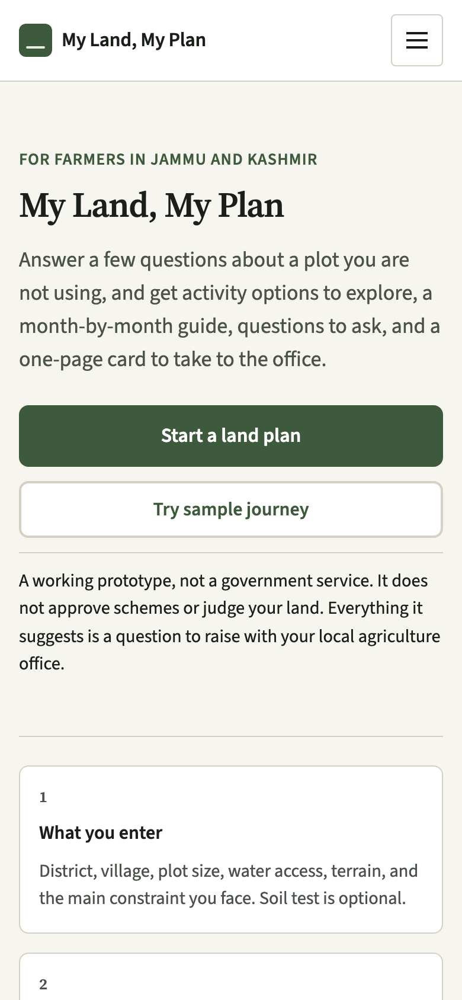
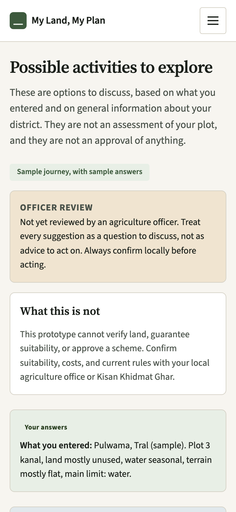
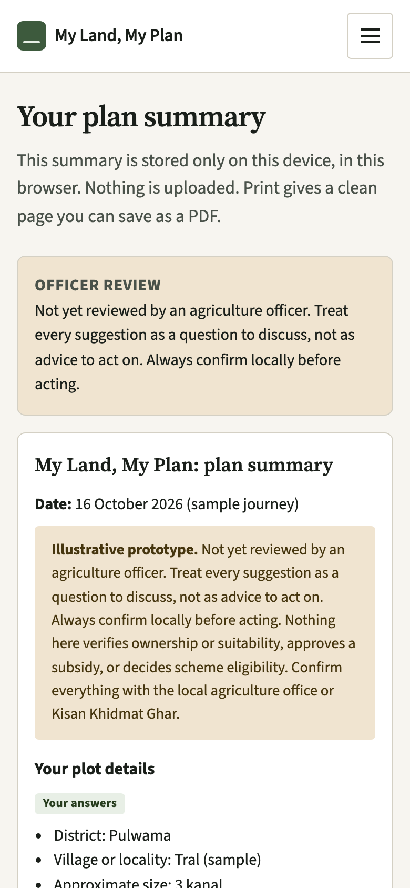
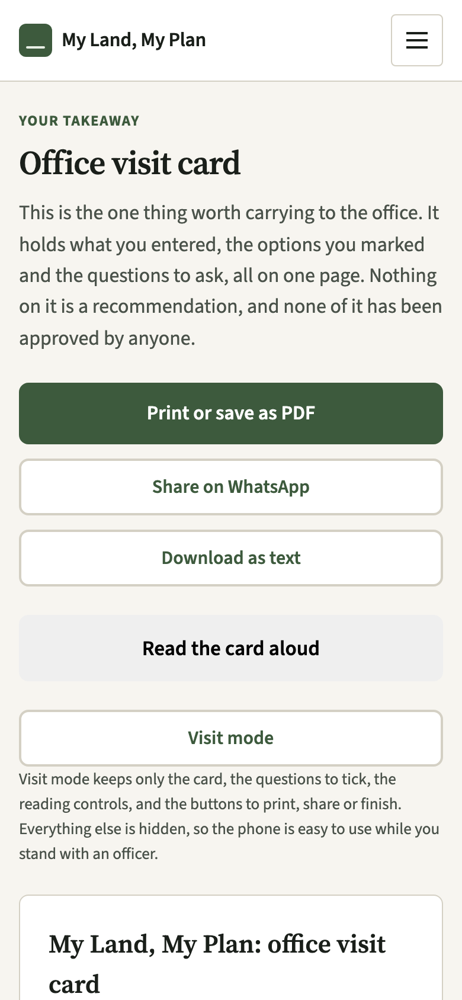

# My Land, My Plan

An offline-first J&K land planning PWA that helps farmers prepare practical
options and office-visit questions without inventing scheme eligibility or crop
guarantees.

**Prepare for the agriculture office visit.**

**Live:** <https://toibawani.github.io/kashmir-land-plan/>

It works with no signal once the page has loaded: the form, the options, the
visit card, the saved plans. Only the weather needs a connection.

## Status

**Version v1.0.0.** Nothing here is signed off by anyone. Three things are open,
and each line comes out only when the data behind it changes:

1. **No officer has reviewed the catalogue.** Every screen that shows a
   suggestion says so. The review process, the printable sheets and the CSV
   importer are in `REVIEW.md`; the fields stay empty until a real reply
   arrives.
2. **No field test has been run.** `FIELD_TEST.md` holds the script and the
   one-page form. No farmer has used the app with anyone watching yet.
3. **Hindi and Urdu are not checked by a native speaker.** Both are marked
   `reviewed: false`, the language menu says so beside the name, and a notice
   stays on screen while either is selected.

The release is [v1.0.0](https://github.com/toibawani/kashmir-land-plan/releases/tag/v1.0.0);
what changed, and what was deliberately left out, is in `CHANGELOG.md`.

It was also only checked in a browser at 360px and in Lighthouse, not in a
hand, in the sun.

Numbers per option are `ask the officer` wherever no public document supported a
figure. `NEEDS_SOURCES.md` is the list of what is still missing. There is no
amount, deadline, yield or income claim anywhere in the app, and the build fails
if one appears.

## What it does

- Takes a district, an altitude zone and four more answers about a plot.
- Suggests two or three activities to **discuss**, with a reason attached to
  each, and says plainly when it has no honest data for a zone.
- Builds an office visit card: the plot details, the options you marked, the
  questions to ask about each one, what to carry, which soil checks are worth
  asking about. It prints as one page, saves on the phone, and shares as plain
  text for WhatsApp.
- Lists official portals, with no amounts, deadlines, eligibility rules or
  document lists invented anywhere.
- Speaks English, Hindi and Urdu, with the Urdu screen laid out right to left.
- Keeps everything on the device. No accounts, no analytics, no backend.

## What it does not do

- It does not decide whether a scheme applies to you, or what it pays.
- It does not predict yield, cost or income, or promise a crop will suit a plot.
- It does not verify land records, ownership, or the size you typed.
- It does not give a field-level forecast. The weather is for a nearby town.
- It does not answer the questions it writes. Those are for an officer.

## Screens

Captured from the running app at a phone viewport on the sample journey.

| Home | Options |
| --- | --- |
|  |  |

| Summary | Office visit card |
| --- | --- |
|  |  |

## Run it

```sh
npm start     # http://127.0.0.1:8080, no install, no dependencies
npm test      # lint, build check, self-tests, logic checks, translation and pack checks
npm run build # the pre-flight check on its own
```

`npm start` serves the folder with gzip, the way the host does. There is no
framework, no bundler and no `node_modules`: the whole app is static files, and
`package.json` exists so the checks have one entry point.

Rebuilding the screenshots needs the server and a headless Chrome:

```sh
npm run screenshots   # Chrome on --remote-debugging-port=9333
npm run phone-check    # the same, at 360px, checking width and tap targets
npm run review-sheets  # the printable sheets and prefilled CSVs, with the version in both
```

After a visit, or after a field test:

```sh
node tools/import-review.js review-sheets/Baramulla.csv --dry-run  # print, write nothing
node tools/import-review.js review-sheets/Baramulla.csv            # record it
npm run feedback-summary field-test-answers.csv                   # counts, write nothing
```

## How it is built

Plain HTML, CSS and JavaScript. No build step, no dependencies, no backend.
`sw.js` precaches the app for offline use and never caches weather. The catalogue
lives in `js/catalogue.js` so an officer can read it on its own; the review
records live in `js/reviews.js` and are validated on load, so a review with no
name or date cannot render as reviewed. Each printed sheet and each prefilled
CSV carries the sheet version (release plus a digest of the catalogue files),
and the importer refuses a sheet printed from a different one.

Languages are one keyed object per language in `js/messages.js`. Adding Kashmiri
later is one object, not a code change. The Urdu layout is right to left, chosen
per language rather than per page.

Checks: `tools/verify.js` (references, offline cache, review rules, contrast,
event wiring), `tools/selftest.js` (172 checks), `tools/tests-logic.js` (179
checks, including the review CSV formats, the sheet version and the field-test
summary),
`tools/translation-check.js` (key parity and a review list),
`tools/lint.js` (no console output, no `eval`, no secrets, no insecure links),
`tools/phone-check.js` (360px layout and tap targets). Lighthouse on the local
server: performance 92, accessibility 100, best practices 100, PWA 100; the
details and the one remaining cost are in `LIGHTHOUSE.md`.

Deployment is GitHub Pages through `.github/workflows/pages.yml`, which runs
`npm test` before it publishes anything.

Which document answers which question is mapped in [`docs/README.md`](docs/README.md).

There is no backend and no key in this repository; what is still worth
reporting, and how, is in `SECURITY.md`.

## Sources

Regional background comes from the Farmer's Guide for Jammu and Kashmir, ICAR,
CSIR-IIIM, the National Mission on Saffron and NITI Aayog; the exact documents
and what each supports are listed on the About screen inside the app and in
`js/sources.js`. Weather and place lookup are Open-Meteo (CC BY 4.0). The two
typefaces come from Google Fonts.

## Licence

MIT, in `LICENSE`. A fork is welcome. Keep the disclaimer on screen: this is not
a government service, and nothing in it is approved by anyone.
